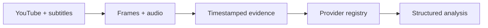

<div align="center">

# Vidsight

### Multimodal YouTube analysis for AI agents

Read the spoken content. Inspect sampled frames. Keep the original timestamps.

[](https://www.python.org/)
[](https://modelcontextprotocol.io/)
[](https://github.com/yt-dlp/yt-dlp)
[](#providers)
[](https://github.com/Songjag/Vidsight-YouTube-Analysis-Skill/stargazers)
[](https://github.com/Songjag/Vidsight-YouTube-Analysis-Skill/watchers)
[](#testing)

**Vidsight** is a Python toolkit and MCP server for evidence-grounded YouTube
video analysis. It combines timestamped subtitles or STT with sampled frames,
then sends one normalized request to the provider selected from configuration.

[Quick start](#quick-start) ·
[MCP tools](#mcp-server) ·
[Providers](#providers) ·
[Architecture](docs/architecture.md) ·
[Documentation](#documentation) ·
[Contributing](CONTRIBUTING.md)

</div>

> **Scope note:** Vidsight analyzes sampled evidence. It does not claim
> continuous viewing when only selected frames are submitted to a model.

## Real test activity

The following GIF was generated from a successful real YouTube analysis run
using Gemini and the Vidsight pipeline:

[](docs/test-activity.md)

Test command:

```sh
LLM_SUPPORTS_IMAGES=true \
.venv/bin/python -m vidsight --env-file .env analyze \
'https://www.youtube.com/watch?v=jNQXAC9IVRw'
```

**Sanitized result:** multimodal source, 19-second video, 12 extracted frames,
2 submitted frames after budgeting, 6 transcript segments, and
`gemini-3.8-flash` with 3,347 total tokens.

## Why Vidsight?

Transcript-only systems miss what is visible on screen: code, diagrams,
terminal output, UI changes, charts, and demonstrations. Sending every video
frame is expensive and noisy. Vidsight keeps the two evidence streams separate,
preserves their timestamps, applies a request budget, and reports what was
actually used.

| Capability | Behavior |
|---|---|
| Speech evidence | YouTube subtitles first, then configured STT backends |
| Visual evidence | OpenCV frame sampling with JPEG MIME and source timestamps |
| AI selection | Explicit provider or one-time `auto` selection |
| Output | Timeline, frame timestamps, analysis, warnings, and evidence source |
| Agent integration | MCP server over stdio with three typed tools |
| Privacy | Sanitized errors and logs; no API keys or raw provider bodies |

## Quick start

### 1. Clone the repository

```sh
git clone https://github.com/Songjag/Vidsight-YouTube-Analysis-Skill.git
cd Vidsight-YouTube-Analysis-Skill
```

### 2. Install

Requirements: **Python 3.11+**, [`ffmpeg`](https://ffmpeg.org/) in `PATH`, and
[`uv`](https://docs.astral.sh/uv/) recommended.

```sh
uv sync
```

### 3. Configure

```sh
cp .env.example .env
```

Then set a provider and a verified model in `.env`:

```dotenv
LLM_PROVIDER=gemini
GEMINI_API_KEY=<private-key>
LLM_MODEL=<verified-model>
LLM_ALLOW_CLOUD=true

# Enable only after verifying that this model supports images.
LLM_SUPPORTS_IMAGES=true
```

Never commit `.env` or paste an API key into an issue or chat.

### 4. Validate and analyze

```sh
# Offline configuration check
uv run vidsight --env-file .env doctor

# Analyze a bounded range
uv run vidsight --env-file .env analyze \
  'https://www.youtube.com/watch?v=VIDEO_ID' \
  --question 'What is the main topic?' \
  --start 0 --end 60
```

Require visual evidence explicitly:

```sh
uv run vidsight --env-file .env analyze \
  'https://www.youtube.com/watch?v=VIDEO_ID' \
  --question 'What action is visible on screen?' \
  --start 0 --end 60 \
  --require-vision
```

`doctor` is intentionally offline. `network_checked=false` and
`model_inference_tested=false` do not mean the configured endpoint is reachable.

## MCP server

Start the stdio server with an absolute `.env` path:

```sh
uv run vidsight --env-file yourpath/Vidsight/.env serve
```

The server reserves stdout for JSON-RPC. Restart it after changing `.env`; do
not pass API keys in tool arguments.

### Official tools

| Tool | Purpose | Parameters |
|---|---|---|
| `watch_video_overview` | Analyze a full video or return its raw timeline | `url` |
| `analyze_video_segment` | Analyze a bounded time range | `url`, `start`, `end`, `question`, `require_vision` |
| `ask_video_question` | Ask a question across the video | `url`, `question`, `require_vision` |

Successful results expose:

```text
video_id
start / end / duration
source
timeline
frame_timestamps
submitted_frame_timestamps
analysis
warnings
```

`frame_timestamps` are extracted frames. `submitted_frame_timestamps` are the
frames remaining after capability and request-budget processing. Errors use
`isError=true` and a sanitized `error.code`/`error.message`.

### Codex

Add the server to `~/.codex/config.toml` and replace paths for your machine:

```toml
[mcp_servers.vidsight]
command = "yourpath/Vidsight/.venv/bin/vidsight"
args = ["--env-file", "yourpath/Vidsight/.env", "serve"]
startup_timeout_sec = 30
tool_timeout_sec = 600
```

### Claude Desktop

Add this entry to `claude_desktop_config.json`:

```json
{
  "mcpServers": {
    "vidsight": {
      "command": "yourpath/Vidsight/.venv/bin/vidsight",
      "args": [
        "--env-file",
        "yourpath/Vidsight/.env",
        "serve"
      ]
    }
  }
}
```

See the [MCP specification](docs/mcp-proposal.md) for the complete schema.

## Providers

Provider selection is configuration-driven. `auto` selects one valid provider
at initialization; it never switches provider after a request failure.

| `LLM_PROVIDER` | Protocol | Status |
|---|---|---|
| `openai` | OpenAI Chat Completions | Mock HTTP tested |
| `openai_compatible` | OpenAI-compatible HTTP | Mock HTTP tested |
| `anthropic` | Anthropic Messages | Mock HTTP tested |
| `gemini` | Gemini `generateContent` | Mock HTTP and real text/vision smoke tested |
| `ollama` | Ollama `/api/chat` | Mock HTTP tested |
| `gguf` | Optional `llama-cpp-python` | Fake runtime tested; real inference not certified |

### Provider examples

<details>
<summary>OpenAI, Anthropic, or Gemini</summary>

```dotenv
# Choose one provider.
LLM_PROVIDER=openai
OPENAI_API_KEY=<private-key>

# Or:
# LLM_PROVIDER=anthropic
# ANTHROPIC_API_KEY=<private-key>

# Or:
# LLM_PROVIDER=gemini
# GEMINI_API_KEY=<private-key>

LLM_MODEL=<verified-model>
# LLM_SUPPORTS_IMAGES=true
```
</details>

<details>
<summary>Local OpenAI-compatible server or Ollama</summary>

```dotenv
# OpenAI-compatible server
LLM_PROVIDER=openai_compatible
LLM_BASE_URL=http://127.0.0.1:1234/v1
LLM_MODEL=<loaded-model>
LLM_ALLOW_CLOUD=false
```

```dotenv
# Ollama native API
LLM_PROVIDER=ollama
OLLAMA_BASE_URL=http://127.0.0.1:11434
OLLAMA_MODEL=<loaded-model>
LLM_ALLOW_CLOUD=false
```
</details>

<details>
<summary>Optional GGUF</summary>

```sh
uv sync --extra local
```

```dotenv
LLM_PROVIDER=gguf
GGUF_MODEL_PATH=/models/model.gguf
LLM_ALLOW_CLOUD=false
GGUF_N_CTX=8192
GGUF_N_GPU_LAYERS=0
```

GGUF does not download models. Vision requires an explicitly supported handler
and projector file; `auto` is text-only.
</details>

## Evidence and privacy

- Unknown model capabilities default to text-only; vision is never inferred
  from a provider name alone.
- Images carry MIME type and original timestamps and are resized to the
  configured limit.
- The default Vidsight budget is up to 12 images with a 1024px maximum side.
- Native video upload is not implemented; Vidsight uses sampled frames.
- `LLM_ALLOW_CLOUD=false` blocks remote AI endpoints. YouTube retrieval still
  requires network access.
- Public errors and logs exclude API keys, authorization headers, full
  transcripts, images, and raw provider response bodies.
- A request failure does not silently switch cloud/local provider.

## STT

Subtitle retrieval is preferred. Depending on configuration, Vidsight can use
Groq Whisper, OpenAI-compatible transcription, or local `faster-whisper`.

```sh
uv sync --extra stt-local
```

Local models must already exist at `STT_MODEL_PATH`; Vidsight does not download
them automatically. Audio is extracted as mono 16 kHz WAV and chunk offsets are
restored to the original video range.

## Architecture

The implementation architecture is documented with a dark-theme Mermaid
diagram:

**[Open the architecture diagram →](docs/architecture.md)**



## Testing

Default tests do not call external services. They use mock HTTP transports,
fake local models, and generated media fixtures.

```sh
uv run pytest -q
uv run ruff check .
uv run vidsight --env-file .env doctor
```

Real provider and YouTube smoke tests are separate from CI and must be reported
as `PASS`, `FAIL`, or `NOT TESTED`.

## Documentation

| Language | Guide |
|---|---|
| English | [docs/en.md](docs/en.md) |
| Tiếng Việt | [docs/vie.md](docs/vie.md) |
| 中文 | [docs/cn.md](docs/cn.md) |
| 日本語 | [docs/jp.md](docs/jp.md) |
| Architecture | [docs/architecture.md](docs/architecture.md) |
| Development | [docs/development.md](docs/development.md) |

## Project identity

| Field | Value |
|---|---|
| Project | `Vidsight` |
| Skill | `vidsight-youtube-analysis` |
| Package | `vidsight` |
| MCP server | `vidsight` |

## License

The project uses the MIT License when a `LICENSE` file is provided by the
repository.
