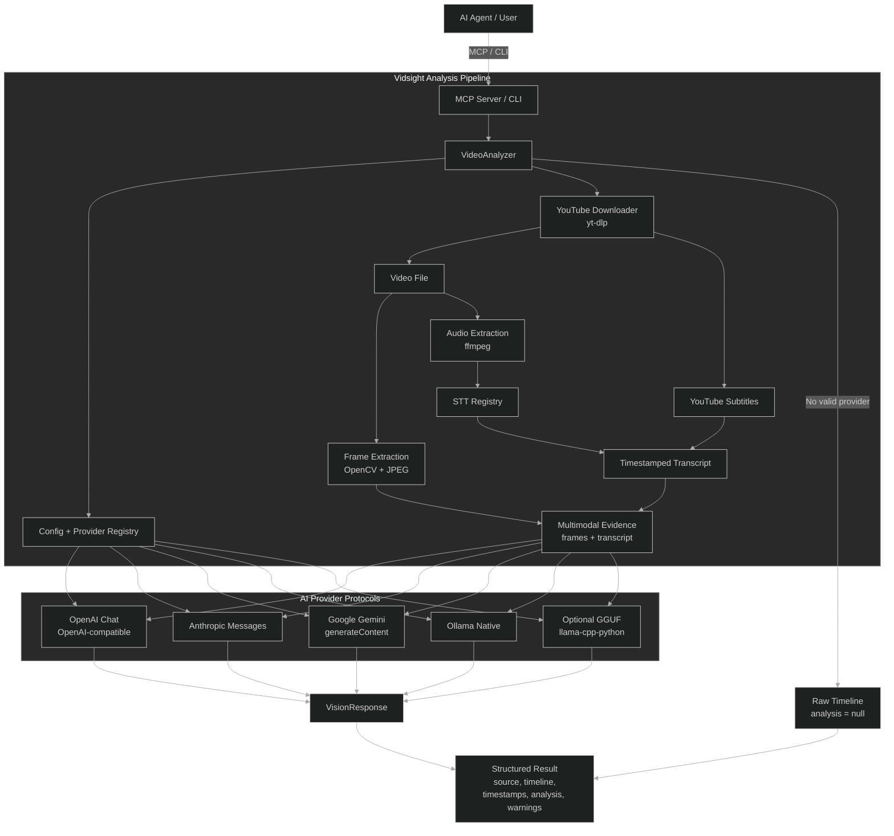

# Vidsight Architecture

Sơ đồ dưới đây mô tả pipeline đang có trong repository. Vidsight lấy video và
phụ đề từ YouTube, trích xuất frame/audio, chuẩn hóa evidence rồi gửi một
request tới provider đã được chọn lúc khởi tạo.

## Luồng xử lý

1. `MCP Server` hoặc CLI tạo `VideoAnalyzer`.
2. `Config` validate policy, model, endpoint và chọn provider một lần.
3. `yt-dlp` tải video; subtitle YouTube được ưu tiên cho transcript.
4. Vidsight trích frame bằng OpenCV và audio bằng `ffmpeg` khi cần STT.
5. Evidence giữ timestamp gốc và được giới hạn theo capability/budget.
6. Registry gọi đúng adapter đã chọn; request lỗi không fallback sang provider
   khác.
7. Kết quả trả `source`, `timeline`, `frame_timestamps`,
   `submitted_frame_timestamps`, `analysis` và `warnings`.

## Các điểm quan trọng

- Model chưa được xác nhận vision sẽ được xem là text-only.
- Native video upload chưa triển khai; pipeline hiện dùng sampled frames.
- `LLM_PROVIDER=auto` chỉ fallback về raw timeline khi không có provider hợp lệ
  lúc khởi tạo; không fallback sau lỗi request.
- `LLM_ALLOW_CLOUD=false` chặn remote AI endpoint, nhưng việc lấy nội dung từ
  YouTube vẫn cần network.
- Log và lỗi public không chứa API key, authorization header, transcript đầy đủ,
  ảnh hoặc raw provider body.

## Source chính

- [`VideoAnalyzer`](../src/vidsight/core/orchestrator.py)
- [`Provider Registry`](../src/vidsight/providers/registry.py)
- [`Provider Configuration`](../src/vidsight/providers/config.py)
- [`Gemini Provider`](../src/vidsight/providers/protocols/gemini.py)
- [`YouTube Media`](../src/vidsight/media/youtube.py)
- [`MCP Server`](../src/vidsight/mcp_server.py)
